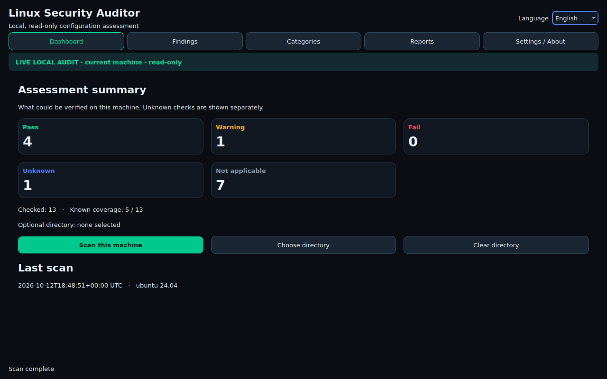

# Linux Security Auditor

[](https://github.com/shomatoff/linux-security-auditor/actions/workflows/ci.yml)

**Understand the security settings you can actually verify on a Linux desktop.** Linux Security Auditor is a local, read-only PySide6 application for a bounded review of Ubuntu and Debian configuration. It separates confirmed findings from unavailable evidence, explains each check, and exports offline reports.

**Languages:** [English](docs/README_EN.md) · [O‘zbekcha](docs/README_UZ.md) · [Русский](docs/README_RU.md)

**Download:** [Linux Security Auditor v1.0.0](https://github.com/shomatoff/linux-security-auditor/releases/tag/v1.0.0) · [Linux x64 archive](https://github.com/shomatoff/linux-security-auditor/releases/download/v1.0.0/Linux-Security-Auditor-Linux-x64.tar.gz) · [SHA256SUMS](https://github.com/shomatoff/linux-security-auditor/releases/download/v1.0.0/SHA256SUMS)



> **Screenshot provenance:** all screenshots below were captured from the running PySide6 application after a real nonprivileged audit on Ubuntu 24.04. They contain no synthetic findings. The visible result is specific to that host and is **not** a security verdict for other machines.

## What it does

- 13 stable checks across OS support, SSH, firewall, local account metadata, APT update metadata, automatic update configuration, and an **optional user-selected** directory permission scan.
- Explicit `PASS`, `WARN`, `FAIL`, `UNKNOWN`, and `NOT_APPLICABLE` results, with evidence source, limitation, impact and manual guidance.
- Background scan worker, category drilldowns, filters, live language switching and persistent language choice.
- Local HTML, PDF and JSON exports; privacy redaction is enabled by default.
- No remote scan, sudo, network upload, package installation, file contents or host changes.

## Screenshots

| Live view | English | Uzbek | Russian |
|---|---|---|---|
| Dashboard | [Open](docs/screenshots/dashboard-en.png) | [Open](docs/screenshots/dashboard-uz.png) | [Open](docs/screenshots/dashboard-ru.png) |

[Live findings](docs/screenshots/findings-live.png) · [Live report preview](docs/screenshots/report-preview-live.png) · [Live settings](docs/screenshots/settings-live.png)

## Quick start

Requires Python 3.12 and a Linux desktop with Qt/XCB libraries. Ubuntu 22.04/24.04 and Debian 12 are the intended initial targets. Python dependencies are pinned in [requirements.txt](requirements.txt); developer tools in [requirements-dev.txt](requirements-dev.txt).

```bash
python3.12 -m venv .venv
.venv/bin/python -m pip install -r requirements.txt
.venv/bin/python main.py
```

Click **Scan this machine**. The optional directory button enables a bounded metadata-only permission review; no directory is scanned by default. Select a finding for evidence and limitations. Use **Reports** to preview or export. Language choice persists across restarts.

For local quality checks and a Linux package:

```bash
.venv/bin/python -m pip install -r requirements-dev.txt
QT_QPA_PLATFORM=offscreen .venv/bin/python -m pytest -q
.venv/bin/python -m ruff check .
./scripts/build_linux.sh
```

The package is created at `dist/packages/Linux-Security-Auditor-Linux-x64.tar.gz`. It is unsigned and depends on compatible Linux desktop libraries. See [platform notes](docs/PLATFORMS.md).

## Architecture and trust boundary

`collectors` gather a bounded set of local evidence; pure `rules` evaluate it; `models` carry the result; `ui` presents it; `reporting` exports it; `i18n` supplies all user text. The collector uses fixed read-only command arguments, no shell, timeouts and output limits. [Architecture](docs/ARCHITECTURE.md) · [Rule catalog](docs/RULE_CATALOG.md) · [Methodology](docs/METHODOLOGY.md)

## Limits

This is a configuration assessment, **not** a penetration test, CIS certification, vulnerability scanner or guarantee of safety. An unprivileged process may be unable to inspect effective firewall rules. SSH `Include`/`Match` or missing service context can make settings inconclusive. APT metadata can be stale. Directory scans skip symlinks and stop at 250 entries/depth 2. The first supported distributions are Ubuntu 22.04/24.04 and Debian 12; other systems are explicitly outside validated scope. Windows packages are not built.

[Testing](docs/TESTING.md) · [Security](docs/SECURITY.md) · [Privacy](docs/PRIVACY.md) · [Changes](docs/CHANGELOG.md)

## Automation and release

[GitHub Actions workflow](.github/workflows/ci.yml) passed lint and tests on Ubuntu 22.04/24.04, built and smoke-tested a Linux package on Ubuntu 24.04, and published the checked archive in the [v1.0.0 release run](https://github.com/shomatoff/linux-security-auditor/actions/runs/38296110751). The published files were downloaded and their checksum verified. Local verification details are in [testing notes](docs/TESTING.md).

Licensed under [MIT](LICENSE).
