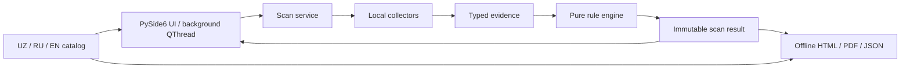

# Architecture

The UI initiates a scan only after the user clicks the live scan button. The worker executes bounded local reads off the UI thread. The collector never evaluates risk; rules never access the host. Reports use the same immutable result as the UI.

Command execution is limited to fixed program/argument pairs in `auditor/collectors/local.py`, uses `shell=False`, and bounds output and time. The optional directory traversal uses `lstat`/`scandir`, skips symbolic links, and does not open files. Language and redaction settings use Qt settings; no audit data is persisted automatically. Exports are generated only on explicit user action.
